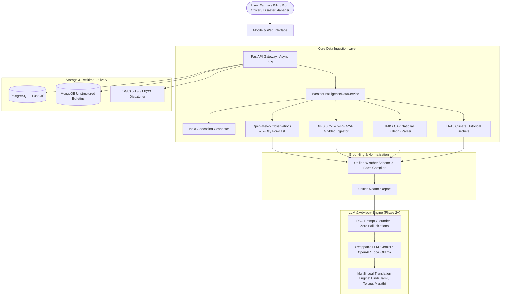

# WeatherGPT System Architecture

WeatherGPT is an open, modular weather intelligence platform tailored for Indian agro-climatic zones, maritime logistics, aviation, urban disaster management, and climate research.

## Non-Negotiable Guarantees

1. **Zero-Hallucination Numbers**: LLM never receives raw unrestricted queries. Every meteorological metric is resolved into `UnifiedWeatherReport.grounded_facts` with exact source citations.
2. **Graceful Degradation**: If an upstream provider times out, fallback algorithms (such as offline Indian location catalogs and regional NCMRWF stability approximations) ensure the service never crashes.
3. **Multi-Persona Decision Support**: Specialized prompts and data extraction for Agriculture (soil moisture, rain probability), Marine (wind gusts, swell, cyclone tiers), Aviation (CAPE, visibility, isobaric wind shear), and Disaster Management (IMD Red/Orange alerts, CAP warnings).
